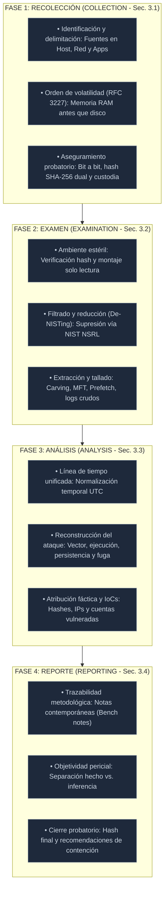

# GUÍA DE INTERPRETACIÓN FORENSE
### Articulación Técnica: NIST SP 800-86 e ISO/IEC 27042:2015

**Maestría en Ciberseguridad y Ciberdefensa**  
*Escuela Superior de Guerra “General Rafael Reyes Prieto”*  
Bogotá D.C., Colombia — 2026

---

**Autores:**  
Carolina Salinas • David Mora Fierro • Juan Nikolas Hernández  
Johana Iden Lambuley Contreras • Jaider Ospina

---

---

## Tabla de Contenido
- [Parte I: Guía de Interpretación NIST SP 800-86](#parte-i-guía-de-interpretación-nist-sp-800-86)
  - [1. Objetivo, Alcance y Marco de Referencia Técnico](#1-objetivo-alcance-y-marco-de-referencia-técnico)
  - [2. Mapa de Procesos: Fases Forenses NIST SP 800-86](#2-mapa-de-procesos-fases-forenses-nist-sp-800-86)
  - [3. Procedimiento Secuencial Operativo y Aseguramiento Criptográfico](#3-procedimiento-secuencial-operativo-y-aseguramiento-criptográfico)
  - [4. Checklist de Cumplimiento Pericial (NIST SP 800-86)](#4-checklist-de-cumplimiento-pericial-nist-sp-800-86)
  - [5. Glosario Técnico-Jurídico y Alcance/Limitaciones](#5-glosario-técnico-jurídico-y-alcance-limitaciones)
- [Parte II: Guía de Interpretación ISO/IEC 27042:2015](#parte-ii-guía-de-interpretación-isoiec-270422015)
  - [1. Objetivo, Alcance y Marco de Referencia Técnico](#1-objetivo-alcance-y-marco-de-referencia-técnico-1)
  - [2. Mapa de Procesos: Fases Forenses ISO/IEC 27042:2015](#2-mapa-de-procesos-fases-forenses-isoiec-270422015)
  - [3. Procedimiento Secuencial Operativo y Aseguramiento Criptográfico](#3-procedimiento-secuencial-operativo-y-aseguramiento-criptográfico-1)
  - [4. Checklist de Cumplimiento Pericial (ISO/IEC 27042)](#4-checklist-de-cumplimiento-pericial-isoiec-27042)
  - [5. Glosario Técnico-Jurídico y Alcance/Limitaciones](#5-glosario-técnico-jurídico-y-alcance-limitaciones-1)
- [Parte III: Caso de Estudio Real — Operación "Shadow Vault"](#parte-iii-caso-de-estudio-real--operación-shadow-vault)

---

# PARTE I: GUÍA DE INTERPRETACIÓN NIST SP 800-86
> *Guía para Integrar Técnicas Forenses en la Respuesta a Incidentes (Guide to Integrating Forensic Techniques into Incident Response)*

## 1. Objetivo, Alcance y Marco de Referencia Técnico

### Objetivo
Sintetizar y operativizar las directrices del **NIST SP 800-86**, estableciendo un marco técnico riguroso y repetible para la recolección, examen, análisis y reporte de evidencia digital durante la contención y erradicación de incidentes de seguridad, garantizando la preservación probatoria frente a auditorías internas o instancias judiciales.

### Perímetro de Aplicación Técnica
Aplica a incidentes de seguridad en infraestructuras locales, virtuales o híbridas donde interactúen tres fuentes principales de datos:
* **Sistemas Anfitriones (*Hosts*):** Memoria volátil (RAM), espacio no asignado (*slack space*), registros del sistema operativo, estructuras de archivos ($MFT$, artefactos de ejecución) y volcados de disco.
* **Redes (*Network Devices*):** Trazas completas de paquetes (PCAP), registros de flujo (*NetFlow/IPFIX*), tablas de enrutamiento y logs de dispositivos perimetrales (Firewalls, IDS/IPS, Proxies).
* **Aplicaciones y Servicios:** Logs transaccionales de bases de datos, servicios web, servidores de autenticación (Active Directory, LDAP, IAM) y plataformas de correo.

### Infraestructura, Hardware Homologado y Ambiente Estéril
* **Bloqueadores de Escritura Físicos (*Write-Blockers*):** Puentes forenses de hardware (SATA/SAS, NVMe, USB 3.0) certificados bajo el programa NIST CFTT (*Computer Forensic Tool Testing*), configurados en modo estricto de solo lectura (*read-only*).
* **Medios de Almacenamiento Estériles:** Unidades receptoras sometidas previamente a borrado seguro de patrones (*zero-fill* de un pase o DoD 5220.22-M), con verificación previa de hash nulo en todos sus sectores.
* **Estación de Trabajo Forense Aislada (*Forensic Workstation*):** Entornos de análisis *air-gapped* (sin interfaz física ni lógica a redes externas), con puertos no esenciales bloqueados a nivel de BIOS/UEFI y montaje de imágenes forenses exclusivamente en modo de solo lectura (`mount -o ro,loop,noexec`).

---

## 2. Mapa de Procesos: Fases Forenses NIST SP 800-86

NIST SP 800-86 estructura el ciclo de vida del análisis forense aplicado a incidentes en cuatro fases continuas, interconectadas e iterativas:

---

## 3. Procedimiento Secuencial Operativo y Aseguramiento Criptográfico

### Procedimiento Técnico Estandarizado (Modo Imperativo)

1. **Asegurar la Escena Digital y Evaluar la Volatilidad:**
   * Evaluar el estado operativo del equipo. Si se encuentra encendido, **no desconectar de la energía** ni apagar el sistema operativo.
   * Aislar el host de la red mediante desconexión física del cable Ethernet o inhabilitación de interfaces inalámbricas, sin suspender los procesos activos.
2. **Ejecutar la Adquisición Volátil en Memoria (RFC 3227):**
   * Conectar un medio USB estéril previamente configurado con binarios forenses estáticos o herramientas portables validadas (ej. WinPmem, LiME).
   * Ejecutar la adquisición de memoria RAM completa, volcando la imagen en crudo (`.raw` o `.bin`) directamente hacia el medio externo.
   * Documentar inmediatamente la hora exacta del volcado en formato UTC, el comando ejecutado y los mensajes arrojados por el aplicativo.
3. **Calcular y Registrar el Hash Criptográfico Dual:**
   * Calcular de inmediato los valores hash **SHA-256** y **SHA-3** sobre el archivo de imagen de memoria obtenido.
   * Registrar las cadenas alfanuméricas resultantes en el formulario formal de cadena de custodia.
4. **Adquirir el Almacenamiento No Volátil (Disco Bit a Bit):**
   * Apagar de forma controlada el equipo si las políticas operativas lo exigen (ej. extracción de batería o desconexión del cable de poder de la fuente en equipos de escritorio para evitar scripts de apagado malicioso).
   * Conectar la unidad de almacenamiento al bloqueador de escritura físico por hardware.
   * Adquirir una imagen bit a bit (*bit-stream image*) en formato pericial estandarizado (`.E01` o `.dd/raw`) hacia el disco de destino estéril.
   * Verificar que el valor hash de verificación generado al cierre de la clonación coincida matemáticamente con el disco de origen.
5. **Generar la Copia de Trabajo en Laboratorio:**
   * Guardar la imagen original en bóveda bajo control de acceso.
   * Clonar una copia exacta de trabajo sobre el almacenamiento estéril de la estación forense para procesar el examen exclusivamente sobre esta réplica.
6. **Ejecutar el Examen y Filtrado de Datos:**
   * Montar la copia de trabajo en modo de solo lectura.
   * Filtrar archivos conocidos del sistema operativo mediante la base de datos de hashes conocidos del NIST (NSRL) para aislar binarios extraños o modificados.
   * Extraer artefactos del registro, historiales de eventos de seguridad (`.evtx`), archivos de paginación (`pagefile.sys`), espacio no asignado y cachés del sistema.
7. **Correlacionar Hallazgos y Construir la Cronología:**
   * Unificar los tiempos de los registros del host con los logs del firewall, proxy e IDS perimetrales, corrigiendo cualquier desviación de reloj local (*clock skew*) con respecto a la hora UTC.
   * Reconstruir la secuencia lógica de eventos para identificar la cuenta de usuario empleada, el proceso ejecutor y los posibles datos exfiltrados.
8. **Consolidar la Bitácora y Emitir el Dictamen:**
   * Integrar la bitácora técnica contemporánea (*bench notes*) con la descripción de herramientas, versiones y parámetros empleados para garantizar la repetibilidad técnica.

### Aseguramiento Criptográfico y Cadena de Custodia

#### Esquema de Hashing Dual
Se debe implementar un esquema de autenticación matemática redundante e independiente:

$$\text{Validez de Integridad} \iff \text{Hash}_{\text{Adquisición}}(\text{SHA-256}) == \text{Hash}_{\text{Análisis}}(\text{SHA-256}) \quad \land \quad \text{Hash}_{\text{Adquisición}}(\text{SHA-3}) == \text{Hash}_{\text{Análisis}}(\text{SHA-3})$$

#### Formato Estricto de Registro de Cadena de Custodia (NIST SP 800-86)

| Parámetro Requerido | Registro Operativo Obligatorio |
| :--- | :--- |
| **Identificador del Caso:** | Código único asignado al incidente (ej. INC-2026-NIST-042). |
| **Elemento Probatorio:** | Número de ítem (ej. EVID-HOST-01, EVID-MEM-01). |
| **Datos de Origen del Hardware:** | Fabricante, modelo, número de serie, capacidad nominal en bytes. |
| **Algoritmos Hash y Valores:** | Resultado completo de SHA-256 y SHA-3 calculados al cierre de captura. |
| **Nombre del Custodio Actual:** | Nombre completo, documento de identidad, área y cargo. |
| **Nombre del Receptor Técnico:** | Nombre completo, documento de identidad, área y cargo. |
| **Fecha, Hora y Zona:** | Registro temporal normalizado (`YYYY-MM-DD hh:mm:ss UTC`). |
| **Propósito de Transferencia:** | Adquisición primaria, ingreso a laboratorio forense, preservación en bóveda. |
| **Firmas de Responsabilidad:** | Rúbrica manuscrita o firma digital con certificado válido de emisor y receptor. |

---

## 4. Checklist de Cumplimiento Pericial (NIST SP 800-86)

| ID | Control Técnico Requerido | Criterio de Verificación Operativa | Cumple (S/N/NA) |
| :--- | :--- | :--- | :---: |
| **CHK-N01** | **Respeto al Orden de Volatilidad** | Se recolectaron las fuentes volátiles (RAM, conexiones, procesos) antes que las unidades fijas de almacenamiento secundario (RFC 3227 / NIST SP 800-86 Sec. 3.1). | [ ] |
| **CHK-N02** | **Aislamiento No Destructivo** | Se aisló el sistema del entorno de red sin forzar el apagado intempestivo ni destruir artefactos en memoria volátil. | [ ] |
| **CHK-N03** | **Bloqueo Físico de Escritura** | Se empleó un puente bloqueador de hardware verificado en modo solo lectura para la extracción de dispositivos físicos de almacenamiento. | [ ] |
| **CHK-N04** | **Integridad Criptográfica Verificada** | Se computaron y documentaron hashes SHA-256/SHA-3 en el punto de captura y se contrastaron antes de iniciar el examen técnico. | [ ] |
| **CHK-N05** | **Uso Exclusivo de Copia de Trabajo** | La imagen original máster quedó intacta bajo custodia; todas las acciones analíticas se ejecutaron sobre un duplicado bit a bit montado en modo de solo lectura. | [ ] |
| **CHK-N06** | **Validación de Herramientas (CFTT)** | Las herramientas empleadas se encuentran testeadas y validadas documentalmente para certificar que no alteran los datos del medio original. | [ ] |
| **CHK-N07** | **Cadena de Custodia Ininterrumpida** | Existe constancia documental firmada de cada traspaso, traslado y cambio de almacenamiento de la evidencia desde su captura. | [ ] |
| **CHK-N08** | **Documentación Contemporánea** | El analista mantuvo bitácora de notas en tiempo real registrando comandos, rutas de ejecución y salidas de software para garantizar repetibilidad. | [ ] |
| **CHK-N09** | **Normalización Temporal UTC** | Todos los eventos temporales de hosts, red y aplicaciones fueron convertidos a UTC y ajustados por desfase de reloj (*clock skew*). | [ ] |
| **CHK-N10** | **Objetividad en el Reporte** | El informe pericial consigna exclusivamente hechos demostrables con base en la evidencia técnica, absteniéndose de juicios penales de dolo o culpabilidad. | [ ] |

---

## 5. Glosario Técnico-Jurídico y Alcance / Limitaciones

### Glosario Técnico-Jurídico Crítico
* **Orden de Volatilidad (*Order of Volatility*):** Secuencia técnica estandarizada (derivada de la RFC 3227 y adoptada por el NIST) que dicta la adquisición de evidencia según su tiempo de vida útil antes de desaparecer: registros de CPU/caché $\rightarrow$ tablas de enrutamiento/caché ARP/procesos/memoria RAM $\rightarrow$ sistema de archivos temporales $\rightarrow$ disco magnético/SSD $\rightarrow$ logs remotos $\rightarrow$ medios de respaldo en cinta.
* **Imagen Bit a Bit (*Bit-Stream Image*):** Duplicación física exacta, sector por sector y bit por bit de un medio digital, incluyendo sectores no asignados (*unallocated space*), espacio holgado (*slack space*) y metadatos del sistema de archivos.
* **De-NISTing:** Proceso de filtrado y exclusión de archivos comunes y no alterados del sistema operativo o software comercial mediante cotejo de hashes contra la *National Software Reference Library* (NSRL) del NIST, reduciendo significativamente el volumen de datos a examinar.
* **Espacio Holgado (*Slack Space*):** Espacio no utilizado que queda entre el final de un archivo real y el final del clúster físico asignado por el sistema de archivos, fuente habitual de fragmentos de evidencia remanente.
* **Tallado de Archivos (*File Carving*):** Técnica de extracción forense que recupera archivos eliminados a partir del análisis de sus cabeceras (*headers*) y pies de página (*footers*) binarios directamente en el flujo de bytes, sin depender de la tabla de asignación de archivos del sistema operativo.
* **Cadena de Custodia (*Chain of Custody*):** Registro documental cronológico ininterrumpido que acredita la recolección, custodia, control, transferencia, análisis y disposición final de la evidencia digital, garantizando que el material presentado ante una autoridad es idéntico al recolectado.
* **Repetibilidad Operativa (*Repeatability*):** Capacidad de que el mismo analista, aplicando los mismos comandos y herramientas sobre el mismo conjunto de datos bajo las mismas condiciones de laboratorio, obtenga exactamente el mismo resultado técnico.
* **Admisibilidad de la Evidencia (*Evidentiary Admissibility*):** Juicio jurídico mediante el cual un tribunal determina si un elemento probatorio digital satisface los requisitos legales y técnicos de autenticidad, integridad y confiabilidad metodológica (criterios *Daubert/Frye* y reglas locales de prueba).

### Alcance y Limitaciones del Estándar NIST SP 800-86
* **No cubre Protocolos Jurídicos Locales:** NIST SP 800-86 es una guía técnica y procedimental de mejores prácticas emanada del gobierno de los Estados Unidos. No reemplaza los códigos de procedimiento penal, normas procesales probatorias ni directrices de policía judicial de jurisdicciones externas.
* **No cubre Criterios Avanzados de Interpretación y Falsación de Hipótesis:** El estándar se concentra en la dimensión operativa de recolección, examen y reporte fáctico. No proporciona un marco epistemológico formal para la formulación y refutación de hipótesis en litigios complejos, aspecto regulado de manera estricta por normas como **ISO/IEC 27042**.
* **No cubre Auditoría de Laboratorios Forenses:** No establece los requisitos de gestión de calidad, acreditación ni calibración de instalaciones periciales (ámbito reservado a **ISO/IEC 17025** e **ISO/IEC 27041**).
* **Dependencia de la Fase de Contención:** Si el equipo de respuesta a incidentes prioriza la restauración del servicio sobre la preservación forense (p. ej., reiniciando servidores o restaurando copias de respaldo antes de adquirir la memoria RAM), la aplicación posterior de NIST SP 800-86 no puede reparar la evidencia destruida (*Principio de Destrucción Irreversible de la Volatilidad*).
* **Prohibición de Calificación Legal:** El alcance del reporte bajo NIST SP 800-86 es estrictamente técnico-fáctico. El analista describe la secuencia de eventos, los privilegios utilizados y los artefactos comprometidos; tiene prohibido emitir calificaciones penales de dolo, tipicidad o imputación de responsabilidad legal.

---
---

# PARTE II: GUÍA DE INTERPRETACIÓN ISO/IEC 27042:2015
> *Directrices para el Análisis y la Interpretación de Evidencia Digital (Guidelines for the Analysis and Interpretation of Digital Evidence)*

## 1. Objetivo, Alcance y Marco de Referencia Técnico

### Objetivo
Sintetizar y operativizar las directrices de la norma **ISO/IEC 27042:2015**, estableciendo un marco metodológico, científico y reproducible para el examen técnico, análisis de hechos, formulación y contraste de hipótesis, y la interpretación contextual de la evidencia digital, asegurando su validez probatoria frente a auditorías y tribunales judiciales.

### Perímetro de Aplicación Técnica
Aplica a la fase analítica e interpretativa posterior a la adquisición de la evidencia. El perímetro abarca:
* **Entornos de Datos Preservados:** Imágenes forenses bit a bit de medios de almacenamiento, volcados de memoria volátil (RAM), registros de tráfico de red y bases de datos transaccionales previamente asegurados bajo **ISO/IEC 27037**.
* **Procesos Cognitivos y Analíticos:** Formulación sistemática de hipótesis técnicas (H1, H0, H2), evaluación de explicaciones alternativas, cuantificación de la incertidumbre técnica y mitigación del sesgo de confirmación.
* **Sustentación Pericial:** Emisión de dictámenes periciales donde se deba auditar el razonamiento lógico-deductivo aplicado por el perito.

### Infraestructura, Hardware Homologado y Ambiente Estéril
* **Estación de Trabajo Forense Aislada (*Forensic Workstation*):** Entornos de análisis *air-gapped* sin conexión a redes públicas o corporativas, con puertos periféricos no autorizados bloqueados a nivel de firmware/BIOS.
* **Medios de Almacenamiento Estériles:** Dispositivos receptores formateados y verificados con patrón de borrado seguro (*zero-fill*), con hash de control nulo previo.
* **Montaje Lógico Inmutable:** Las imágenes de trabajo deben montarse exclusivamente en modo de solo lectura estricto mediante el sistema operativo (`mount -o ro,loop,noexec` o sistemas de archivos con soporte forense de solo lectura).
* **Validación de Métodos y Herramientas:** Todo software utilizado (de código abierto o comercial) debe contar con validación documental previa conforme a los principios de **ISO/IEC 27041**, garantizando que produce resultados repetibles y no introduce artefactos artificiales.

---

## 2. Mapa de Procesos: Fases Forenses ISO/IEC 27042:2015

```mermaid
flowchart TD
    classDef isoPhase fill:#0f172a,stroke:#f59e0b,stroke-width:2px,color:#f8fafc;
    classDef isoStep fill:#1e293b,stroke:#64748b,stroke-width:1px,color:#cbd5e1;

    subgraph I1 ["FASE 1: PLANIFICACIÓN (PLANNING - Cl. 6)"]
        I1_A["• Delimitación pericial: Mandato y preguntas de investigación"]
        I1_B["• Competencia técnica: Acreditación de idoneidad y ausencia de sesgos"]
        I1_C["• Selección metodológica: Herramientas validadas (ISO/IEC 27041)"]
    end
    class I1 isoPhase;
    class I1_A,I1_B,I1_C isoStep;

    subgraph I2 ["FASE 2: PROCESAMIENTO (DATA PROCESSING - Cl. 7.2)"]
        I2_A["• Control de entrada: Verificación hash SHA-256 (ISO 27037)"]
        I2_B["• Ambiente inmutable: Montaje de copia en solo lectura (ro)"]
        I2_C["• Extracción de artefactos: Carving, metadatos y De-NISTing"]
    end
    class I2 isoPhase;
    class I2_A,I2_B,I2_C isoStep;

    subgraph I3 ["FASE 3: ANÁLISIS DE HECHOS (FACT-FINDING - Cl. 7.3)"]
        I3_A["• Super-Timeline: Reconstrucción cronológica integral en UTC"]
        I3_B["• Asociación lógica: Correlación usuarios, sockets, procesos y MACB"]
        I3_C["• Detección de anomalías: Vacíos temporales y antiforense"]
    end
    class I3 isoPhase;
    class I3_A,I3_B,I3_C isoStep;

    subgraph I4 ["FASE 4: INTERPRETACIÓN (INTERPRETATION - Cl. 8)"]
        I4_A["• Formulación de hipótesis: H1 principal vs. H0/H2 de descargo"]
        I4_B["• Prueba de falsación: La evidencia respalda o refuta cada tesis"]
        I4_C["• Control de incertidumbre: Mitigación de sesgo confirmatorio"]
    end
    class I4 isoPhase;
    class I4_A,I4_B,I4_C isoStep;

    subgraph I5 ["FASE 5: REPORTE PERICIAL (REPORTING - Cl. 9)"]
        I5_A["• Objetividad fáctica: Separación hecho demostrado vs. deducción"]
        I5_B["• Auditabilidad probatoria: Repetibilidad y reproducibilidad"]
        I5_C["• Cierre formal: Hash final de evidencia y firma pericial"]
    end
    class I5 isoPhase;
    class I5_A,I5_B,I5_C isoStep;

    I1 --> I2
    I2 --> I3
    I3 --> I4
    I4 --> I5
```

---

## 3. Procedimiento Secuencial Operativo y Aseguramiento Criptográfico

### Procedimiento Técnico Estandarizado (Modo Imperativo)

1. **Verificar la Integridad Criptográfica de Ingreso:**
   * Calcular de inmediato los valores hash (SHA-256 y SHA-3/512) de las imágenes forenses recibidas antes de efectuar cualquier operación.
   * Contrastar los resultados con el acta de cadena de custodia de entrega (procedente de ISO/IEC 27037). Si los valores no coinciden, rechazar la muestra.
2. **Generar la Copia de Trabajo en Medio Estéril:**
   * Almacenar la imagen réplica original en la bóveda de evidencia digital bajo acceso restringido.
   * Generar una copia forense bit a bit hacia el almacenamiento de trabajo y montarla estrictamente en modo de solo lectura lógica (`ro`).
3. **Ejecutar el Examen Técnico y Extracción de Artefactos:**
   * Extraer metadatos del sistema de archivos ($MFT$, $LogFile$, journal), volcados de memoria RAM y registros transaccionales.
   * Aplicar filtrado de archivos conocidos del sistema mediante cotejo de listas de hashes validadas (NSRL) para aislar elementos anómalos.
4. **Construir la Línea Temporal Unificada (*Super-Timeline*):**
   * Normalizar todas las marcas de tiempo (modificación, acceso, creación, nacimiento - MACB) al estándar UTC (ISO 8601).
   * Correlacionar cronológicamente los eventos del sistema operativo con eventos de red y registros de auditoría de aplicaciones.
5. **Formular y Contrastar Hipótesis Periciales (Cláusula Central ISO 27042):**
   * Redactar formalmente la **Hipótesis Principal (H1)** (ej. *"El usuario utilizó credenciales válidas para transferir el archivo X mediante el canal Y"*).
   * Formular explícitamente al menos una **Hipótesis Alternativa (H0/H2)** (ej. *"Un artefacto malicioso ejecutado de manera remota automatizó la transferencia sin conocimiento del usuario"* o *"Ocurrió una alteración de marcas de tiempo vía timestomping"*).
   * Evaluar si la evidencia técnica hallada sustenta, contradice o es neutra frente a cada una de las hipótesis planteadas.
6. **Cuantificar la Incertidumbre Analítica:**
   * Identificar vacíos de datos temporales (*time-gaps*), espacio no asignado sobreescrito o registros de auditoría truncados.
   * Consignar el nivel de certidumbre técnica de los hallazgos sin sobredimensionar las conclusiones.
7. **Documentar y Emitir el Dictamen Pericial:**
   * Registrar en notas contemporáneas (*bench notes*) cada comando, versión de herramienta utilizada y parámetro configurado para garantizar que otro analista obtenga el mismo resultado.
   * Redactar el dictamen pericial diferenciando de forma inequívoca los hechos comprobados de las inferencias técnicas.

### Aseguramiento Criptográfico y Cadena de Custodia

#### Esquema de Hashing Dual
La integridad de la prueba en la fase analítica descansa en la equivalencia matemática determinista e independiente:

$$\text{Integridad Analítica} \iff \text{Hash}_{\text{Entrada}}(\text{SHA-256}) == \text{Hash}_{\text{Salida}}(\text{SHA-256}) \quad \land \quad \text{Hash}_{\text{Entrada}}(\text{SHA-3}) == \text{Hash}_{\text{Salida}}(\text{SHA-3})$$

#### Formato Estricto de Registro de Cadena de Custodia Analítica (ISO/IEC 27042)

| Parámetro Requerido | Registro Operativo Obligatorio |
| :--- | :--- |
| **Identificador del Caso:** | Código de radicado pericial (ej. PER-2026-ISO-27042-019). |
| **Identificador de Evidencia:** | Identificador unívoco del contenedor/imagen (ej. EVID-IMG-01). |
| **Descripción del Elemento:** | Tipo de contenedor (`.E01`, `.raw`, `.dd`), tamaño exacto en bytes, fuente de adquisición. |
| **Valor Hash de Control (SHA-256):** | Hash de 64 caracteres calculado al ingresar al proceso analítico. |
| **Valor Hash de Respaldo (SHA-3/512):** | Hash de 128 caracteres para verificación cruzada independiente. |
| **Perito / Analista Responsable:** | Nombre completo, documento de identidad, matrícula/acreditación profesional. |
| **Fecha, Hora y Zona:** | Marca temporal de inicio y fin de custodia (`YYYY-MM-DD hh:mm:ss UTC`). |
| **Operación Realizada:** | Extracción de metadatos, análisis de memoria, contraste de hipótesis, archivo en bóveda. |
| **Declaración de Integridad:** | Firma digital o manuscrita certificando la ausencia de alteraciones en el soporte analizado. |

---

## 4. Checklist de Cumplimiento Pericial (ISO/IEC 27042)

| ID | Control Obligatorio | Criterio de Verificación Normativo | Cumple (S/N/NA) |
| :--- | :--- | :--- | :---: |
| **CHK-I01** | **Competencia del Analista** | El perito cuenta con formación demostrable, experiencia y habilidades acreditadas para el análisis específico que realiza (ISO/IEC 27042 Cl. 6.2). | [ ] |
| **CHK-I02** | **Integridad Criptográfica de Entrada** | Verificación documentada de que el valor hash de la imagen de trabajo coincide al 100% con el hash de la evidencia original preservada. | [ ] |
| **CHK-I03** | **Repetibilidad (*Repeatability*)** | El perito documentó parámetros, scripts y comandos de modo que el mismo analista en el mismo entorno obtenga idénticos resultados (ISO 27042 Cl. 7.3). | [ ] |
| **CHK-I04** | **Reproducibilidad (*Reproducibility*)** | La metodología descrita permite que un perito independiente, aplicando métodos equivalentes, arribe a las mismas conclusiones fácticas (ISO 27042 Cl. 7.4). | [ ] |
| **CHK-I05** | **Idoneidad de Herramientas** | Se emplearon herramientas forenses cuya confiabilidad fue validada y documentada previamente frente a fallos o alteración de datos (ISO/IEC 27041). | [ ] |
| **CHK-I06** | **Formulación de Hipótesis Alternativas** | Se plantearon y evaluaron explícitamente hipótesis de descargo o explicaciones técnicas contrarias a la acusación/reclamo principal (ISO 27042 Cl. 8.4). | [ ] |
| **CHK-I07** | **Mitigación del Sesgo Cognitivo** | Se aplicaron controles para neutralizar el sesgo de confirmación, examinando la evidencia exculpatoria con el mismo rigor que la inculpatoria. | [ ] |
| **CHK-I08** | **Bitácora Contemporánea (*Bench Notes*)** | Se mantuvieron notas técnicas de trabajo fechadas cronológicamente en tiempo real, registrando cada decisión y hallazgo del análisis. | [ ] |
| **CHK-I09** | **Distinción Hecho vs. Interpretación** | El informe pericial separa de manera tajante los hechos técnicos comprobables de las inferencias e interpretaciones del perito. | [ ] |
| **CHK-I10** | **Declaración Expresa de Incertidumbre** | Se delimitaron con precisión los márgenes de error, vacíos de información o limitaciones tecnológicas que condicionan las conclusiones del dictamen. | [ ] |

---

## 5. Glosario Técnico-Jurídico y Alcance / Limitaciones

### Glosario Técnico-Jurídico Crítico
* **Análisis (*Analysis*):** Proceso metódico de evaluación y extracción de datos desestructurados con el fin de identificar artefactos, reconstruir cronologías y establecer hechos comprobables de manera técnica e independiente.
* **Interpretación (*Interpretation*):** Proceso cognitivo y deductivo mediante el cual el perito atribuye significado contextual a los hechos descubiertos durante el análisis, vinculando la evidencia con los sucesos investigados.
* **Repetibilidad (*Repeatability*):** Principio forense que establece que un mismo analista, trabajando en el mismo laboratorio, con las mismas herramientas y el mismo conjunto de datos, debe obtener resultados idénticos.
* **Reproducibilidad (*Reproducibility*):** Principio procesal y probatorio según el cual un perito distinto, trabajando en un laboratorio diferente y con herramientas técnicas análogas pero independientes, alcanza las mismas conclusiones sustantivas sobre la evidencia.
* **Contraste de Hipótesis (*Hypothesis Testing*):** Metodología científica exigida por la norma en la que se formulan hipótesis rivales (H1 frente a H0/H2) y se someten a pruebas de falsación mediante los artefactos hallados para descartar explicaciones erróneas.
* **Sesgo de Confirmación (*Confirmation Bias*):** Tendencia cognitiva del investigador a buscar, interpretar o favorecer únicamente la información que confirma sus creencias preconcebidas o la hipótesis de quien contrata el peritaje; ISO 27042 exige su mitigación activa.
* **Incertidumbre Analítica (*Analytical Uncertainty*):** Reconocimiento técnico del margen de duda inherente a la pericia, motivado por sobreescritura de espacio no asignado, truncamiento de logs, desfase horario o ausencia de artefactos corroborantes.
* **Admisibilidad Probatoria (*Admissibility of Evidence*):** Idoneidad jurídica de un informe pericial para ser valorado formalmente por un juez, condicionada a que sus métodos posean rigor científico, repetibilidad y ausencia de arbitrariedad técnica (*estándares Daubert/Frye*).

### Alcance y Limitaciones del Estándar ISO/IEC 27042:2015
* **Deslinde dentro de la Suite Forense ISO:**
  * No cubre Adquisición ni Preservación (resorte exclusivo de **ISO/IEC 27037**).
  * No cubre Validación General de Software (regulado por **ISO/IEC 27041**).
  * No cubre la Gestión Global de Incidentes (orquestación corporativa bajo **ISO/IEC 27043** e **ISO/IEC 27035**).
* **Limitaciones Técnicas y de Entorno:**
  * Inexistencia de Prescripciones de Software: Define principios metodológicos, no herramientas comerciales ni sintaxis operativa.
  * Dependencia de la Calidad de Entrada (*GIGO*): No subsana errores cometidos durante la recolección física inicial.
* **Frontera Jurídica y Prohibición de Tipicidad Penal:**
  * Subordinación Procesal: No sustituye las reglas de admisibilidad probatoria de los códigos procesales de cada país.
  * Prohibición Deontológica: El perito describe hechos técnicos y grados de certeza probatoria; tiene **estrictamente prohibido** emitir juicios penales de dolo, culpabilidad o tipificar delitos, función reservada al juez.

---
---

# PARTE III: CASO DE ESTUDIO REAL — OPERACIÓN "SHADOW VAULT"
> *Análisis Crítico Articulado: NIST SP 800-86 e ISO/IEC 27042:2015*

## 1. Descripción del Incidente

### Contexto Institucional e Infraestructura Comprometida
* **Entidad Afectada:** *Financiera Andina S.A.*, multinacional financiera con sede en Bogotá D.C.
* **Servidor Core Bancario (`DB-CORE-01`):** Servidor físico HPE ProLiant DL380 Gen10, Red Hat Enterprise Linux 8.8, Oracle Database 19c Enterprise. Aloja tablas de cuentas, saldos y órdenes SWIFT.
* **Controlador de Dominio (`DC01-BOG`):** Windows Server 2022 virtualizado sobre VMware vSphere 7.0 (Kerberos y GPO).
* **Perímetro de Seguridad:** Clúster FortiGate 600E con inspección SSL/TLS profunda y reenvío Syslog a SIEM Splunk.

### Cronología Fáctica de los Hechos (UTC)
* **2026-09-14 23:15:10 UTC:** Conexión VPN SSL exitosa del usuario `j.sarmiento` desde IP residencial de Bogotá (`190.27.112.45`), superando MFA push tras una campaña previa de fatiga y spear-phishing.
* **2026-09-14 23:22:04 UTC:** Conexión RDP desde la VPN hacia `DC01-BOG`. A través de este equipo, se abre túnel SSH hacia `DB-CORE-01` mediante llave RSA autorizada preexistente.
* **2026-09-14 23:45:30 UTC:** En `DB-CORE-01` se ejecuta `export_trans.sh`, invocando `expdp` de Oracle y generando un volcado de 42 GB (`trans_sep2026.dmp`).
* **2026-09-15 01:10:15 UTC:** Compresión y cifrado mediante `7za` en `/var/tmp/backup_tmp.dat` (peso resultante: **34.2 GB**). Eliminación del `.dmp` original con `rm -f`.
* **2026-09-15 01:35:00 UTC:** Inicio de transferencia SFTP de salida hacia VPS externo en Linode (`45.33.32.156:2222`).
* **2026-09-15 02:08:42 UTC:** Disparo de alarma DLP/SIEM por tráfico saliente superior a 10 GB fuera de horario.
* **2026-09-15 02:15:00 UTC:** Analista del SOC Nivel 1 ejecuta comandos no auditados (`w`, `kill -9`) y **desconecta físicamente el cable de energía del servidor `DB-CORE-01`**.

---

## 2. Análisis Forense Aplicado (Metodología Combinada)

### Aplicación Táctica NIST SP 800-86
1. **Preservación de Memoria Volátil (RFC 3227):**
   * En `DC01-BOG` se capturó la RAM completa (32 GB) usando `WinPmem 4.0` sobre medio USB estéril (`DC01-RAM.raw`).
   * En `DB-CORE-01` la memoria se perdió irreversiblemente por el corte eléctrico intempestivo.
2. **Adquisición No Volátil y Aseguramiento Criptográfico:**
   * Bloqueador físico Tableau SAS/SATA Bridge y generación de imagen E01 (`DB-CORE.E01`).
   * Hashing dual computado:
     $$\text{SHA-256} = \texttt{7c89f5a2b8...b412} \quad \land \quad \text{SHA-3/512} = \texttt{9f01c3d8a1...a871}$$
3. **Examen Técnico (De-NISTing y Carving):**
   * Reducción de más de 180,000 archivos estándar vía NIST NSRL.
   * Recuperación mediante *carving* de fragmentos de `export_trans.sh` en el espacio no asignado de `/var/tmp/`.

### Aplicación Metodológica ISO/IEC 27042:2015
1. **Super-Timeline UTC:** Correlación entre logs del firewall FortiGate, visor de eventos de Windows y llamadas al sistema *auditd* de Linux.
2. **Formulación y Contraste de Hipótesis:**
   * **H1 (Acusación - Acción Deliberada del Empleado):** `j.sarmiento` sustrajo deliberadamente la base de datos.
   * **H2 (Compromiso Remoto - Adversario Externo):** La estación del empleado fue vulnerada y su sesión secuestrada.
   * **H3 (Transferencia Incompleta):** La exfiltración no se completó debido a la interrupción de la conexión.
3. **Pruebas de Falsación:**
   * El análisis de memoria de `DC01-BOG` demostró inyección de un implante **Cobalt Strike (Beacon)** operando como proxy SOCKS5 desde infraestructura Tor, refutando la autoría material directa de Sarmiento (**H1 descartada; H2 confirmada**).
   * La comparación entre el tamaño del archivo cifrado (34.2 GB) y los bytes reales transferidos por firewall (11.8 GB) confirmó que la exfiltración fue parcial (**H3 confirmada**; solo 34.5% transmitido).

---

## 3. Evaluación Crítica de Admisibilidad Probatoria

### Solidez de la Evidencia Técnica
* **Imágenes Forenses E01 y Memoria:** Plena validez y admisibilidad bajo criterios *Daubert/Frye*. Coincidencia al 100% en verificación de hashes criptográficos.
* **Logs de Firewall y SIEM:** Válidos por sincronización NTP stratum-2 y almacenamiento centralizado inmutable WORM.

### Resolución de Fallas en la Cadena de Custodia y Procedimiento
* **Falla 1: Pérdida de RAM por Apagado Intempestivo (Violación NIST SP 800-86):**
  * *Impacto:* Pérdida de sockets efímeros y de la clave simétrica de `7za`.
  * *Subsanación (ISO 27042):* Declaración formal de incertidumbre analítica y reconstrucción fáctica mediante registros de *auditd* (`syscall execve`). Se aplicó el principio de duda razonable (*in dubio pro reo*) respecto a la presunta complicidad del empleado.
* **Falla 2: Lapso no documentado en Cadena de Custodia (1h 45m):**
  * *Impacto:* Impugnación por presunta manipulación o siembra de pruebas.
  * *Subsanación Criptográfica:* Cotejo de registros biométricos del centro de cómputo y verificación de identidad matemática estricta: los hashes SHA-256 calculados al ingresar al laboratorio coincidieron en un 100% con los generados al momento de la extracción del disco duro ($P = 1 \text{ en } 2^{256}$).

---

**Documento elaborado conforme a los estándares de la Escuela Superior de Guerra "General Rafael Reyes Prieto"**  
*Bogotá D.C., Colombia — 2026*

