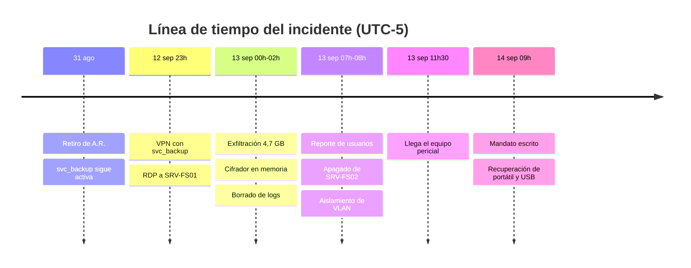
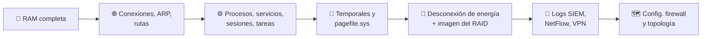

# 🔍 Caso de Aplicación Forense
### Dictamen Pericial · RFC 3227 + ACPO

**Caso DF-2026-017 · Exfiltración y cifrado de información en Distribuidora Andina S.A.S.**

-8957e5?style=for-the-badge)

---

## 👥 Integrantes

| | Nombre |
|:-:|---|
| 🧑‍💻 | Johan Camilo Tamara |
| 👩‍💻 | Natalia Forero Lozano |
| 👩‍💻 | Laura Gutiérrez Torres |
| 👩‍💻 | Ayda Castro Suárez |

---

## 📑 Tabla de contenido

1. [Datos del dictamen y objeto de la pericia](#-1-datos-del-dictamen-y-objeto-de-la-pericia)
2. [Descripción del incidente](#-2-descripción-del-incidente)
3. [Análisis forense aplicado](#-3-análisis-forense-aplicado)
4. [Dilemas forenses y preguntas orientadoras](#-4-dilemas-forenses-y-preguntas-orientadoras)
5. [Hallazgos técnicos](#-5-hallazgos-técnicos)
6. [Evaluación de admisibilidad](#-6-evaluación-de-admisibilidad)
7. [Análisis crítico-propositivo y conclusiones](#-7-análisis-crítico-propositivo-y-conclusiones)
8. [Referencias](#-referencias)

---

## 📋 1. Datos del dictamen y objeto de la pericia

> [!IMPORTANT]
> **Dictamen:** la evidencia de memoria, logs remotos e imagen del servidor de archivos es **admisible**; la imagen del portátil del exadministrador es **admisible con reservas**, y la copia de la USB hallada en el puesto de trabajo **debe excluirse o readquirirse**.
>
> Caso simulado de alta fidelidad, construido para aplicar la Guía Lite RFC 3227 + ACPO del Grupo 2.

| Campo | Contenido |
|---|---|
| **Tipo de documento** | Informe técnico de incidente con estructura de dictamen pericial |
| **Caso** | DF-2026-017 · Exfiltración y cifrado de información en Distribuidora Andina S.A.S. (empresa ficticia, Bogotá) |
| **Solicitante** | Gerencia General y apoderado judicial de la empresa (mandato escrito del 14 de septiembre de 2026) |
| **Equipo pericial** | Grupo 2 – Informática Forense (líder designado conforme al principio 4 de ACPO) |
| **Marco aplicado** | RFC 3227 (BCP 55, 2002) y ACPO Good Practice Guide for Digital Evidence v5 (2012), integrados en la Guía Lite del Grupo 2; Ley 527 de 1999, Ley 906 de 2004 (arts. 254-266), Ley 1273 de 2009 |
| **Preguntas del solicitante** | 1) ¿Hubo acceso no autorizado y exfiltración de datos? 2) ¿Desde qué cuenta y equipo? 3) ¿La evidencia recolectada es apta para sustentar una denuncia penal por los arts. 269A, 269F y 269D del Código Penal? |

> [!NOTE]
> Los nombres de personas, direcciones IP y valores hash son **ficticios** y se presentan abreviados con fines académicos.

---

## 🚨 2. Descripción del incidente

Un exadministrador de sistemas, retirado el 31 de agosto de 2026, conservó una **cuenta de servicio con privilegios de dominio**. Entre el 12 y el 13 de septiembre la usó por VPN para copiar la base de clientes, desplegar un cifrador sin archivo (*fileless*) en el servidor de archivos y borrar los registros locales de eventos.

### 🕒 2.1 Cronología de los hechos
Hora Colombia, UTC-5

| Fecha y hora | Hecho | Fuente que lo acredita |
|---|---|---|
| `31-ago-2026` | Retiro del administrador "A.R."; se deshabilita su cuenta personal, pero **no** la cuenta de servicio `svc_backup` | Acta de retiro, Active Directory |
| `12-sep 23:41` | Conexión VPN exitosa con `svc_backup` desde IP residencial `190.xx.xx.17` | Logs del firewall reenviados al SIEM |
| `12-sep 23:58` | Acceso RDP al servidor de archivos `SRV-FS01` | Logs del SIEM (evento 4624, tipo 10) |
| `13-sep 00:20–01:35` | Compresión y transferencia de **4,7 GB** (carpeta CLIENTES) hacia un almacenamiento en la nube | NetFlow del firewall |
| `13-sep 01:52` | Ejecución de PowerShell codificado que inyecta un cifrador en memoria; inicia el cifrado de recursos compartidos | Volcado de RAM (hallazgo posterior) |
| `13-sep 02:05` | Borrado del registro de seguridad local (evento 1102) | SIEM: último evento recibido antes del borrado |
| `13-sep 07:10` | Empleados reportan archivos con extensión `.andx` y nota de rescate | Mesa de ayuda |
| `13-sep 07:40` | ⚠️ **Técnico interno apaga `SRV-FS02`** (réplica) "para frenar el cifrado" | Declaración del técnico |
| `13-sep 08:15` | Se aísla la VLAN de servidores sin apagar `SRV-FS01` | Bitácora de TI |
| `13-sep 11:30` | Llega el equipo pericial; se activa la Guía Lite | Bitácora pericial |
| `14-sep 09:00` | Mandato escrito de la gerencia; recuperación del portátil corporativo del exadministrador y de una USB hallada en su antiguo puesto | Acta de entrega |

### 🖥️ 2.2 Infraestructura comprometida

- **`SRV-FS01`** — servidor de archivos Windows Server 2022, disco RAID 1 de 2 × 2 TB (HDD), encendido y con el cifrador activo en memoria.
- **`SRV-FS02`** — réplica Windows Server 2022 con SSD NVMe de 1 TB, apagado por el técnico interno.
- **Firewall perimetral y VPN**, con reenvío de registros al **SIEM** en un servidor separado.
- **Controlador de dominio `DC01`**, donde reside la cuenta `svc_backup`.
- **Portátil corporativo** asignado al exadministrador (SSD SATA 512 GB con BitLocker) y **memoria USB** de 64 GB.

### 🗂️ 2.3 Artefactos disponibles

| Artefacto | Origen | Volatilidad (RFC 3227 §2.1) |
|---|---|---|
| Volcado de RAM de 32 GB | `SRV-FS01` en caliente | 🔴 Nivel 2 – alta |
| Estado de red, procesos, sesiones, tareas programadas | `SRV-FS01` en caliente | 🔴 Nivel 2 – alta |
| Imagen forense del RAID | `SRV-FS01` | 🟡 Nivel 4 – disco |
| Imagen forense del SSD NVMe | `SRV-FS02` (apagado) | 🟡 Nivel 4 – disco |
| Exportación de logs del SIEM, NetFlow y VPN | Colector remoto | 🟢 Nivel 5 – registro remoto |
| Imagen del portátil (con clave de recuperación de BitLocker) | Portátil del exadministrador | 🟡 Nivel 4 – disco |
| Copia de la USB de 64 GB | Puesto de trabajo | 🟡 Nivel 4 – disco |
| Fotografías, diagrama de red, configuración del firewall | Sitio | 🔵 Nivel 6 – configuración física |

---

## 🧪 3. Análisis forense aplicado

Se aplicaron las **nueve fases** de la Guía Lite; siete se cumplieron por completo y dos presentan desviaciones que ocurrieron antes de la llegada del equipo o en la entrega de la USB. Cada fila cita la sección de la guía y la norma base.

### ✅ 3.1 Cumplimiento por fase

| Fase (Guía Lite) | Acción ejecutada | Norma base | Cumplimiento |
|---|---|---|:-:|
| **1. Planear** | Mandato escrito con alcance (servidores, SIEM, portátil, USB); líder designado; verificación del hash SHA-256 del kit de respuesta antes de salir | ACPO Planear, P4; RFC 3227 §2 | ✅ Cumple |
| **2. Asegurar escena** | Restricción de acceso al cuarto de servidores; 46 fotografías de pantallas y conexiones; registro del desfase del reloj de `SRV-FS01` (+2 min 14 s frente a la hora legal) | RFC 3227 §2; ACPO P1 | ✅ Cumple |
| **3. Decidir** | `SRV-FS01` encendido, cifrador activo solo en memoria y volumen sin cifrado de disco: se decide **adquisición en vivo** y se justifica por escrito. `SRV-FS02` ya estaba apagado: no se enciende | RFC 3227 §2.2; ACPO P2 | ✅ Cumple (decisión justificada) |
| **4. Captura volátil** | Desde USB de solo lectura con binarios confiables: 1) RAM con WinPmem (32 GB, 11 min); 2) conexiones, ARP, rutas, procesos, servicios, sesiones y tareas; 3) archivos temporales y `pagefile.sys`. Salida en disco externo estéril; hash de cada archivo al crearlo | RFC 3227 §2.1, §3.2, §5 | ✅ Cumple |
| **5. Contener** | Tras la captura volátil, desconexión física de la energía de `SRV-FS01` (no apagado ordenado) para evitar rutinas de borrado al cerrar sesión | RFC 3227 §2.2 | ✅ Cumple |
| **6. Adquirir** | RAID de `SRV-FS01` y SSD de `SRV-FS02` con bloqueador Tableau y FTK Imager (E01); portátil con `dc3dd` tras desbloqueo con la clave de recuperación custodiada por TI; hashes SHA-256 y SHA3-256 coincidentes en origen e imagen | ACPO P1, P3; RFC 3227 §3.2 | ✅ Cumple |
| **6b. USB del puesto** | El jefe de TI la conectó a su propio equipo el 14-sep 08:30 y copió archivos con el explorador antes de entregarla | ACPO P1, P2 | ❌ **No cumple** |
| **7. Preservar y archivar** | Rotulado, sellado y embalaje antiestático; registro de custodia; dos copias de trabajo verificadas; original en caja fuerte con bitácora de acceso | RFC 3227 §4.1; CPP arts. 254-266 | ⚠️ Cumple con un vacío (ver §6) |
| **8. Analizar** | Solo sobre copias: Volatility 3 (memoria), Autopsy y Plaso (línea de tiempo), verificación cruzada de artefactos con X-Ways; registro de herramienta, versión y parámetros | ACPO P3 | ✅ Cumple |
| **9. Presentar** | Este documento, con anexos de bitácora, hashes y custodia; el perito puede sustentar cada paso | ACPO Presentar, P2, P4 | ✅ Cumple |

### 🔢 3.2 Orden de adquisición aplicado en `SRV-FS01`

1. **Memoria RAM completa** — contiene el cifrador inyectado y la línea de comandos de PowerShell decodificable.
2. **Conexiones de red activas, caché ARP y tabla de rutas** — sesión RDP aún abierta hacia la IP de la VPN.
3. **Lista de procesos, servicios, sesiones de usuario y tareas programadas** — persistencia creada por el atacante.
4. **Archivos temporales y `pagefile.sys`.**
5. **Desconexión de energía y adquisición del RAID** con bloqueador.
6. **Exportación firmada de logs** del SIEM, NetFlow y VPN desde el colector remoto.
7. **Configuración del firewall** y fotografía de la topología.

### 🔐 3.3 Aseguramiento criptográfico (extracto)

| Evidencia | SHA-256 (abreviado) | SHA3-256 (abreviado) | Verificación en análisis |
|---|:-:|:-:|---|
| **EV-01** RAM `SRV-FS01` | `9f2c…a71e` | `41bd…07c3` | ✅ Coincide |
| **EV-02** Imagen RAID `SRV-FS01` | `3a88…5d10` | `c0e7…9b42` | ✅ Coincide |
| **EV-03** Imagen SSD `SRV-FS02` | `77d1…e0aa` | `5f13…2c68` | ✅ Coincide |
| **EV-04** Logs SIEM, NetFlow, VPN | `b604…19fe` | `e2a9…7d01` | ✅ Coincide |
| **EV-05** Imagen portátil | `0c4e…88b3` | `9a71…f6d5` | ✅ Coincide |
| **EV-06** Copia USB | `d19a…3c27` | `6be0…41a8` | ⚠️ Coincide con la copia, pero el original ya había sido alterado |

---

## ⚖️ 4. Dilemas forenses y preguntas orientadoras

El caso reúne los tres desafíos que pide el taller: **volatilidad extrema**, **técnicas antiforenses** y **evidencia dañada o fragmentada**.

| Dilema | Situación | Decisión adoptada y fundamento |
|---|---|---|
| 💨 **Volatilidad extrema** | El cifrador vivía solo en memoria; apagar `SRV-FS01` lo habría borrado junto con la clave de cifrado y la sesión RDP activa | Captura en vivo siguiendo el orden de volatilidad (RFC 3227 §2.1) y justificación escrita del acceso al original por perito competente (ACPO P2) |
| 🧹 **Antiforense: borrado de logs** | El evento 1102 indica que el registro local de seguridad fue vaciado | Se priorizó el registro remoto (SIEM) que el atacante no alcanzó; RFC 3227 lo ubica como fuente independiente de nivel 5 |
| 🕰️ **Antiforense: *timestomping*** | Fechas de creación alteradas en los archivos comprimidos antes de exfiltrarlos | Contraste de las marcas `$STANDARD_INFORMATION` contra `$FILE_NAME` en la MFT y contra el NetFlow |
| 💾 **Evidencia dañada: SSD con TRIM** | `SRV-FS02` fue apagado y luego el controlador del SSD purgó bloques liberados | No se encendió de nuevo; se declaró en el informe que el espacio no asignado no es recuperable de forma repetible |
| 🧩 **Evidencia fragmentada: archivos cifrados** | Parte de la carpeta CLIENTES quedó cifrada | La clave extraída de la RAM permitió descifrar copias de trabajo; el original se conserva cifrado |
| 🔌 **Alteración previa: USB** | El jefe de TI abrió la USB sin bloqueador | Se documentó la alteración, se adquirió la USB tal como fue entregada y se recomienda no fundar conclusiones solo en ella |

### ❓ Preguntas orientadoras y respuesta técnica

<b>¿Por qué adquisición en vivo y no "desconectar y llevar al laboratorio"?</b>

 

Porque el elemento más probatorio (el cifrador y su clave) estaba **solo en RAM**. La ACPO v5 admite el acceso al sistema vivo cuando se justifica y lo ejecuta una persona competente; RFC 3227 prohíbe apagar antes de recolectar lo volátil.

<b>¿Por qué ese orden de adquisición?</b>

 

Se siguió la escala del RFC 3227: memoria y estado de red antes que temporales, disco y logs remotos. Los logs remotos, aunque valiosos, no se pierden en minutos.

<b>¿Cómo se evitó contaminar el sistema durante la captura en vivo?</b>

 

Binarios estáticos desde medio de solo lectura, salida a disco externo, sin abrir archivos ni ejecutar antivirus; cada comando quedó en la bitácora con su hora.

<b>¿Qué acción correctiva se aplicó ante el apagado de SRV-FS02?</b>

 

No se intentó "repararlo": se adquirió el disco tal como estaba, se documentó la declaración del técnico y se limitó el alcance de las conclusiones que dependen de él.

<b>¿Qué se hizo con la USB alterada?</b>

 

Adquirirla, calcular sus hashes, registrar la cadena de manos previa y corroborar su contenido con fuentes independientes antes de usarlo.

---

## 🔎 5. Hallazgos técnicos

> [!TIP]
> Cuatro fuentes independientes vinculan la cuenta `svc_backup` y el portátil del exadministrador con la exfiltración de 4,7 GB y con el cifrado; **ninguna conclusión depende solo de la USB alterada**.

| # | Hallazgo | Evidencia que lo sustenta | Corroboración |
|:-:|---|---|---|
| **H1** | La sesión RDP activa en `SRV-FS01` pertenecía a `svc_backup` y venía de la IP asignada por la VPN al túnel abierto desde `190.xx.xx.17` | EV-01 (RAM: sesiones y conexiones), EV-04 (VPN) | Coinciden IP, puerto y hora |
| **H2** | Un PowerShell codificado en Base64 descargó e inyectó el cifrador en un proceso legítimo; la clave AES se recuperó de la memoria | EV-01 (Volatility 3: `windows.cmdline`, `windows.malfind`) | Descifrado exitoso de copias de trabajo |
| **H3** | 4,7 GB salieron hacia un proveedor de almacenamiento en la nube entre las 00:20 y la 01:35 | EV-04 (NetFlow) | Archivo comprimido residual en EV-02 con el mismo tamaño aproximado |
| **H4** | El registro local de seguridad se borró a las 02:05 (evento 1102) | EV-04 (SIEM) | Ausencia de eventos locales posteriores en EV-02 |
| **H5** | El portátil del exadministrador guarda el perfil de VPN con la cuenta `svc_backup` y un historial de navegador con acceso al mismo proveedor de nube la noche del 12 de septiembre | EV-05 | Coincide con H1 y H3 |
| **H6** | La USB contiene un script similar al PowerShell de H2, pero sus marcas de tiempo de acceso son del 14 de septiembre (manipulación del jefe de TI) | EV-06 | ⚠️ Indicio débil: solo de apoyo |

### 💬 Respuestas a las preguntas del solicitante

| Pregunta | Respuesta |
|---|---|
| 1️⃣ ¿Hubo acceso no autorizado y exfiltración? | **Sí**, hubo acceso no autorizado y exfiltración. |
| 2️⃣ ¿Desde qué cuenta y equipo? | Desde la cuenta **`svc_backup`**, por VPN, con artefactos coincidentes en el portátil del exadministrador. |
| 3️⃣ ¿La evidencia es apta para la denuncia? | **Sí**, con la reserva sobre la USB indicada en la sección 6. |

---

## 🏛️ 6. Evaluación de admisibilidad

Cuatro de las seis evidencias son sólidas; la imagen del portátil queda admisible con reserva menor y la copia de la USB no debe sustentar por sí sola ninguna conclusión. La valoración usa los **cinco criterios de RFC 3227** (§2.4, consideraciones legales) y el **art. 11 de la Ley 527 de 1999** (confiabilidad en la generación, conservación e integridad).

| Evidencia | Admisible | Auténtica | Completa | Confiable | Creíble | Dictamen |
|---|:-:|:-:|:-:|:-:|:-:|---|
| **EV-01** RAM `SRV-FS01` | ✅ | ✅ | ✅ | ✅ | ✅ | 🟢 Sólida; adquisición en vivo justificada (ACPO P2) |
| **EV-02** Imagen RAID `SRV-FS01` | ✅ | ✅ | ✅ | ✅ | ✅ | 🟢 Sólida |
| **EV-03** Imagen SSD `SRV-FS02` | ✅ | ✅ | 🟡 Parcial | ✅ | ✅ | 🟢 Sólida en lo adquirido; el espacio no asignado se perdió por TRIM tras el apagado |
| **EV-04** Logs SIEM, NetFlow, VPN | ✅ | ✅ | ✅ | ✅ | ✅ | 🟢 Sólida; fuente independiente del sistema atacado |
| **EV-05** Imagen portátil | ✅ | ✅ | ✅ | ✅ | ✅ | 🟡 Admisible con reserva por el vacío de custodia F2 |
| **EV-06** Copia USB | 🟡 Discutible | 🟡 Parcial | ✅ | ❌ | 🔻 Baja | 🔴 Excluir como prueba principal; solo indicio de apoyo |

### ⛓️ 6.1 Fallas de cadena de custodia y su resolución

| Falla | Riesgo procesal | Resolución aplicada |
|---|---|---|
| **F1.** Apagado de `SRV-FS02` por personal no pericial antes de la llegada del equipo | La defensa puede alegar pérdida de evidencia exculpatoria | Declaración escrita del técnico con hora y motivo; ninguna conclusión depende de EV-03; limitación declarada en el dictamen |
| **F2.** Vacío de 6 horas en el registro de custodia del portátil (14-sep, de 12:00 a 18:00, sin firma de recepción en bodega) | Duda sobre la integridad entre la recolección y la bodega | El sello número 004127 llegó intacto y fotografiado; el hash calculado al adquirir coincide con el verificado en análisis; se obtuvo declaración juramentada del custodio; se corrigió el formato con nota aclaratoria, sin tachaduras |
| **F3.** USB manipulada por el jefe de TI sin bloqueador (violación de ACPO P1 y P2) | Contaminación: cambios en marcas de acceso y posible escritura de archivos del sistema | Registro detallado de lo que hizo el jefe de TI; la USB se adquirió tal como fue entregada; su contenido solo se usa si lo corrobora otra fuente (H6) |
| **F4.** Desfase de 2 min 14 s en el reloj de `SRV-FS01` | Inconsistencias aparentes en la línea de tiempo | Desfase medido y fotografiado al llegar; todas las horas del informe se normalizaron a la hora legal colombiana |

> [!NOTE]
> Con estas medidas, un tercero independiente puede repetir las adquisiciones y los análisis a partir de las copias y obtener los mismos hashes y hallazgos, que es el núcleo del **principio 3 de ACPO**.

---

## 🧠 7. Análisis crítico-propositivo y conclusiones

La combinación RFC 3227 + ACPO resolvió bien lo técnico (qué recoger primero, cómo no alterar, cómo dejar rastro), pero las dos fallas graves del caso ocurrieron **antes de que llegara un perito**. El punto débil no fue el método sino la **ausencia de un protocolo de primera respuesta** para el personal interno.

<table>
<tr>
<th width="50%">💪 7.1 Fortalezas observadas</th>
<th width="50%">⚠️ 7.2 Debilidades de los marcos frente al caso</th>
</tr>
<tr>
<td valign="top">

- El orden de volatilidad del RFC 3227 permitió recuperar el cifrador y su clave, que no existían en disco.
- El principio 2 de ACPO dio respaldo formal a la adquisición en vivo, que de otro modo podría tacharse de alteración.
- El principio 3 de ACPO, unido al doble hash, hace repetible cada resultado por un perito de la contraparte.
- La preferencia del RFC por fuentes remotas neutralizó el borrado de logs locales.

</td>
<td valign="top">

- Ninguno fija algoritmo hash ni formato de imagen; la Guía Lite lo suplió con SHA-256 + SHA3-256 y E01.
- El RFC 3227 (2002) no trata SSD, TRIM ni cifrado de disco completo; la ACPO v5 (2012) lo hace de forma general. La pérdida en `SRV-FS02` lo evidencia.
- Ambos asumen que quien llega primero es personal entrenado; en una empresa, el primer interviniente suele ser TI interna.
- Ninguno cubre la exfiltración a la nube: la evidencia del destino solo puede obtenerse por solicitud formal al proveedor.

</td>
</tr>
</table>

### 🚀 7.3 Propuestas

| Propuesta | Responsable | Plazo sugerido |
|---|---|:-:|
| Protocolo de primera respuesta de una página para TI: no apagar, aislar red, fotografiar, llamar al perito | Jefatura de TI | `30 días` |
| Kit de respuesta preparado y verificado (USB de solo lectura con binarios y herramientas de captura de RAM) | Seguridad de la información | `30 días` |
| Retención mínima de 180 días en el SIEM con integridad garantizada (almacenamiento WORM o firma de lotes) | Seguridad de la información | `90 días` |
| Procedimiento de retiro de personal que incluya cuentas de servicio y revisión de privilegios | Talento humano y TI | `Inmediato` |
| Formación de dos funcionarios internos en adquisición en vivo y custodia, para cumplir ACPO P2 | Gerencia | `6 meses` |
| Complementar la guía con ISO/IEC 27037 para nube y dispositivos móviles | Equipo forense | `Próxima revisión` |

### 🏁 7.4 Conclusión pericial

> [!IMPORTANT]
> La evidencia recolectada bajo la Guía Lite RFC 3227 + ACPO acredita, de forma **auténtica, íntegra y repetible**, el acceso no autorizado con la cuenta `svc_backup`, la exfiltración de 4,7 GB y el despliegue del cifrador. Las fallas F1 a F4 están identificadas, documentadas y mitigadas, y ninguna afecta a las conclusiones principales.
>
> 📌 Se recomienda presentar **EV-01, EV-02, EV-04 y EV-05 como prueba principal** y **EV-03 y EV-06 solo como apoyo**.

---

## 📚 Referencias

- [RFC 3227 – Guidelines for Evidence Collection and Archiving (BCP 55)](https://www.rfc-editor.org/info/rfc3227), IETF, 2002.
- [ACPO Good Practice Guide for Digital Evidence v5](https://www.digital-detective.net/acpo-good-practice-guide-for-digital-evidence/), 2012.
- [Estado vigente de la guía ACPO v5, revisión de 2021](https://knowledgehub.group/web/national-standards/live-standards/-/ddl_display/ddl/71443377/362284494/maximized), Knowledge Hub (National Standards).
- Ley 527 de 1999, Ley 906 de 2004 y Ley 1273 de 2009, República de Colombia.

---

**Grupo 2 · Informática Forense**

Caso simulado con fines académicos · Todos los nombres, IP y hashes son ficticios

