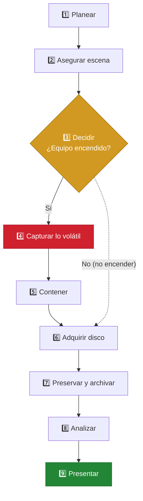

<div align="center">

# 🛡️ Guía Lite de Interpretación
### RFC 3227 + Guía de Buenas Prácticas ACPO (v5)

**Recolección, preservación y archivo de evidencia digital**


-8957e5?style=for-the-badge)


</div>

---

## 👥 Integrantes

| | Nombre |
|:-:|---|
| 🧑‍💻 | Johan Camilo Tamara |
| 👩‍💻 | Natalia Forero Lozano |
| 👩‍💻 | Laura Gutiérrez Torres |
| 👩‍💻 | Ayda Castro Suárez |

---

## 📑 Tabla de contenido

1. [Objetivo y alcance](#-1-objetivo-y-alcance)
2. [Marco de referencia](#-2-marco-de-referencia)
3. [Principios rectores integrados](#-3-principios-rectores-integrados)
4. [Mapa de procesos](#️-4-mapa-de-procesos)
5. [Requisitos y herramientas](#-5-requisitos-y-herramientas)
6. [Procedimiento secuencial](#-6-procedimiento-secuencial)
7. [Aseguramiento de la prueba](#-7-aseguramiento-de-la-prueba)
8. [Checklist de cumplimiento](#-8-checklist-de-cumplimiento)
9. [Glosario técnico-jurídico](#-9-glosario-técnico-jurídico)
10. [Alcance y limitaciones](#️-10-alcance-y-limitaciones)

---

## 🎯 1. Objetivo y alcance

> [!IMPORTANT]
> **Objetivo.** Proveer al perito o al equipo de respuesta a incidentes un instrumento único, verificable y repetible para **identificar, recolectar, preservar, archivar, analizar y presentar** evidencia digital, de modo que el elemento material probatorio conserve su **autenticidad, integridad y trazabilidad** y sea admisible ante un juez o una junta directiva.

**🔭 Perímetro técnico.** Estaciones de trabajo y servidores (Windows/Linux), equipos de red y sus registros, memoria volátil, medios de almacenamiento extraíble y registros centralizados (SIEM/syslog). La guía cubre desde la llegada al sitio hasta la entrega del dictamen.

> [!NOTE]
> Los dispositivos móviles, la nube y los sistemas OT/ICS se tratan solo en lo que los principios generales permiten (ver [sección 10](#️-10-alcance-y-limitaciones)).

---

## 📖 2. Marco de referencia

| Documento | Identificación formal | Aporte a esta guía |
|---|---|---|
| 📘 **[RFC 3227](https://www.rfc-editor.org/info/rfc3227)** (BCP 55) | *Guidelines for Evidence Collection and Archiving*. D. Brezinski y T. Killalea, IETF, febrero de 2002. Categoría «Best Current Practice»; no ha sido actualizado ni reemplazado por otro RFC. | Principios de recolección, **orden de volatilidad**, acciones a evitar, privacidad, consideraciones legales (admisible, auténtica, completa, confiable, creíble), procedimientos de recolección y archivo, kit de herramientas. |
| 📗 **[Guía ACPO v5](https://www.digital-detective.net/acpo-good-practice-guide-for-digital-evidence/)** | *ACPO Good Practice Guide for Digital Evidence*, Association of Chief Police Officers (Reino Unido), finalizada en oct. 2011 y publicada en mar. 2012. ACPO pasó a ser el NPCC en 2015; la guía fue [revisada en 2021 y considerada vigente](https://knowledgehub.group/web/national-standards/live-standards/-/ddl_display/ddl/71443377/362284494/maximized). | **Cuatro principios** (no alteración, competencia, registro auditable/repetibilidad, responsabilidad del líder) y ciclo **Planear → Capturar → Analizar → Presentar**. |
| 🇨🇴 **Complementos (Colombia)** | Ley 527 de 1999 (mensajes de datos, art. 11 criterios de valoración); Ley 906 de 2004, arts. 254-266 (cadena de custodia); Ley 1273 de 2009 (delitos informáticos); Ley 1581 de 2012 (datos personales); Manual del Sistema de Cadena de Custodia de la FGN. | Traducen los principios técnicos a requisitos de admisibilidad procesal en el contexto nacional. |

---

## 🧭 3. Principios rectores integrados

| # | Principio (síntesis propia) | Fuente | Efecto práctico |
|:-:|---|---|---|
| **P1** | 🚫 Ninguna acción debe modificar los datos que puedan llegar a presentarse ante el tribunal. | ACPO 1 | Bloqueador de escritura; trabajar sobre copias. |
| **P2** | 🎓 Si es inevitable acceder al original, solo lo hace una persona competente capaz de explicar su relevancia e implicaciones. | ACPO 2 · RFC 3227 §2 | Adquisición en vivo justificada y documentada. |
| **P3** | 📝 Todo proceso aplicado debe quedar registrado de forma que un tercero independiente obtenga el mismo resultado. | ACPO 3 · RFC 3227 §2 | Bitácora, hashes, versiones de herramientas. |
| **P4** | 👤 Quien dirige la investigación responde por el cumplimiento de la ley y de estos principios. | ACPO 4 | Líder designado y firma del dictamen. |
| **P5** | ⏱️ Recolectar primero lo más volátil; recolectar antes de analizar. | RFC 3227 §2, §2.1 | Orden de volatilidad (sección 4). |
| **P6** | 🧰 Minimizar cambios, no confiar en los binarios del sistema comprometido y eliminar vías externas de alteración. | RFC 3227 §2, §2.2, §5 | Kit en medio de solo lectura; aislamiento de red controlado. |
| **P7** | 🔏 Respetar la privacidad y la política de seguridad del sitio; no recolectar fuera del mandato. | RFC 3227 §2.3 · Ley 1581 | Autorización escrita; minimización de datos. |

---

## 🗺️ 4. Mapa de procesos

<sub>9 fases · 1 decisión</sub>



Las fases 1 a 9 se recorren en orden; si el equipo está **apagado**, el paso 3 salta directamente a la adquisición del disco (línea punteada), **sin encenderlo**.

### ⏳ Orden de volatilidad (RFC 3227 §2.1) aplicado a la fase 4

| Orden | Artefacto | Herramienta sugerida (ejemplo) | Vida útil aprox. |
|:-:|---|---|:-:|
| 🔴 **1** | Registros de CPU y caché | No adquiribles en la práctica; se reflejan en el volcado de RAM | Nanosegundos |
| 🔴 **2** | Tabla de enrutamiento, caché ARP, tabla de procesos, estadísticas del kernel, memoria RAM | WinPmem / Magnet RAM Capture / AVML / LiME; `netstat`, `arp`, `route` desde binarios confiables | Segundos a minutos |
| 🟠 **3** | Sistemas de archivos temporales (`/tmp`, pagefile, swap) | Copia lógica o incluida en la imagen | Minutos a horas |
| 🟡 **4** | Disco (almacenamiento persistente) | FTK Imager, Guymager, `dc3dd` + bloqueador | Días a años |
| 🟢 **5** | Registro remoto y datos de monitoreo (SIEM, syslog, NetFlow) | Exportación firmada desde el colector | Según retención |
| 🔵 **6** | Configuración física y topología de red | Fotografía, diagramas, configuración de equipos | Meses |
| 🟣 **7** | Medios de archivo (backups, cintas) | Imagen o custodia física | Años |

> [!TIP]
> Las duraciones son orientativas; el RFC fija el **orden**, no los tiempos.

---

## 🧰 5. Requisitos y herramientas

| Categoría | Requisito mínimo | Ejemplos homologados / validados |
|---|---|---|
| 🔩 **Hardware** | Bloqueador de escritura probado; estación forense dedicada; medios de destino nuevos o borrados de forma verificable; jaula o bolsa Faraday; cámara; kit de embalaje y sellos. | Tableau T35u/TX1, WiebeTech Forensic UltraDock; discos destino con certificado de borrado. |
| 💿 **Software de adquisición** | Herramientas validadas (con reporte de prueba propio o de NIST CFTT), versión registrada, hash del ejecutable. | FTK Imager, Guymager, dc3dd, ewfacquire; WinPmem, AVML, LiME; KAPE / Velociraptor para triage. |
| 🔬 **Software de análisis** | Herramientas reconocidas y, cuando sea posible, verificación cruzada con una segunda herramienta. | Autopsy/The Sleuth Kit, Volatility 3, X-Ways, Magnet AXIOM, Plaso/log2timeline, Wireshark. |
| 🧪 **Ambiente estéril** | Kit de respuesta en medio de solo lectura con binarios compilados estáticamente (RFC 3227 §5); medios de destino esterilizados y verificados; red de laboratorio aislada; reloj sincronizado por NTP. | USB con interruptor de escritura o DVD-R; registro del hash del kit antes de cada uso. |
| 🧑‍⚖️ **Personal** | Perito con formación acreditable y capacidad de sustentar (ACPO P2); testigo de las actuaciones. | Certificaciones GCFA, EnCE, CHFI o equivalentes; hoja de vida pericial. |

---

## 🔁 6. Procedimiento secuencial

<details open>
<summary><b>1️⃣ Planear</b></summary>

- Obtener la autorización escrita (orden judicial o mandato corporativo) y delimitar el alcance.
- Designar al líder responsable (P4) y al equipo competente (P2); preparar y verificar el kit (hash del kit).
</details>

<details open>
<summary><b>2️⃣ Asegurar</b></summary>

- Aislar la escena y restringir el acceso; fotografiar pantallas, conexiones y etiquetas.
- Registrar la hora del sistema frente a la hora oficial (desfase). **No apagar ni encender equipos todavía.**
</details>

<details open>
<summary><b>3️⃣ Decidir</b></summary>

- Si el equipo está apagado, **no encenderlo**: pasar a la adquisición del disco.
- Si está encendido, valorar cifrado, procesos maliciosos activos y conexiones; documentar la justificación de la adquisición en vivo.
</details>

<details open>
<summary><b>4️⃣ Capturar lo volátil</b></summary>

- Ejecutar solo binarios del kit confiable, nunca los del sistema comprometido; escribir la salida en un medio externo, no en el disco evidencia.
- Seguir el orden de volatilidad (sección 4): **RAM → estado de red y procesos → temporales**.
- Calcular el hash de cada archivo generado inmediatamente después de crearlo.
</details>

<details open>
<summary><b>5️⃣ Contener</b></summary>

- Desconectar de la red solo después de capturar el estado de red, salvo riesgo activo que obligue a hacerlo antes (justificar).
- Evitar acciones que alteren tiempos MAC (búsquedas, antivirus, apertura de archivos); si existen rutinas destructivas, preferir desconectar la energía tras la captura volátil en lugar de un apagado ordenado.
</details>

<details open>
<summary><b>6️⃣ Adquirir</b></summary>

- Conectar el medio original a través del bloqueador de escritura.
- Generar la imagen bit a bit (E01 o RAW) y calcular SHA-256 y SHA3-256 del origen y de la imagen; **deben coincidir**.
</details>

<details open>
<summary><b>7️⃣ Preservar y archivar</b></summary>

- Rotular, sellar y embalar el original (antiestático); diligenciar el registro de cadena de custodia.
- Crear al menos dos copias de trabajo verificadas por hash; almacenar el original en bodega con acceso controlado.
</details>

<details open>
<summary><b>8️⃣ Analizar</b></summary>

- Trabajar exclusivamente sobre copias; verificar el hash antes y después de cada sesión.
- Registrar herramienta, versión, parámetros, hora y resultado de cada paso para garantizar repetibilidad (P3).
</details>

<details open>
<summary><b>9️⃣ Presentar</b></summary>

- Redactar el dictamen con hechos, método, hallazgos, limitaciones y conclusiones separadas de opiniones.
- Sustentar ante la autoridad; anexar bitácora, hashes y registros de custodia.
</details>

---

## 🔐 7. Aseguramiento de la prueba

**Autenticación criptográfica.** Calcular **dos funciones hash independientes**, SHA-256 (familia SHA-2) y SHA3-256 (familia Keccak), sobre el medio original, la imagen y cada artefacto volátil. El uso dual hace inviable en la práctica una colisión simultánea y reemplaza el uso histórico de MD5/SHA-1, hoy desaconsejado. Registrar el valor completo en la bitácora y en el rótulo.

> [!WARNING]
> MD5 y SHA-1 están **desaconsejados** como único mecanismo de integridad.

```bash
sha256sum /dev/sdb > origen.sha256
openssl dgst -sha3-256 /dev/sdb > origen.sha3
dc3dd if=/dev/sdb of=evid01.dd hash=sha256 log=evid01.log
sha256sum evid01.dd   # debe coincidir con origen.sha256
```

```powershell
# Windows (PowerShell)
Get-FileHash .\mem.raw -Algorithm SHA256
# SHA3-256:
openssl dgst -sha3-256 mem.raw
```

### 📋 Formato mínimo de registro de cadena de custodia
<sub>Compatible con los formatos de rotulado y continuidad de la FGN</sub>

| Campo | Contenido |
|---|---|
| 🏷️ **Identificación** | Nº de caso, Nº de EMP/EF, descripción (marca, modelo, serial, capacidad), ubicación exacta del hallazgo. |
| 🔒 **Integridad** | SHA-256 y SHA3-256 completos, herramienta y versión, estado del sello (número de sello). |
| 🔗 **Continuidad** | Fecha y hora (UTC-5) de cada entrega; nombre, cargo, documento y firma de quien entrega y de quien recibe; motivo del traslado. |
| 📦 **Condiciones** | Embalaje, almacenamiento (temperatura, antiestático), observaciones de alteración o daño. |

---

## ✅ 8. Checklist de cumplimiento

Requisitos obligatorios para dotar de validez una pericia bajo este marco; la fuente va entre paréntesis.

- [ ] Existe autorización escrita y alcance definido antes de intervenir *(ACPO Planear · RFC 3227 §2)*.
- [ ] Hay un líder designado responsable del cumplimiento legal y de los principios *(ACPO P4)*.
- [ ] El personal que accedió al original es competente y puede sustentar sus actos *(ACPO P2)*.
- [ ] La escena fue fotografiada y se registró el desfase del reloj del sistema *(RFC 3227 §2)*.
- [ ] La captura volátil siguió el orden de volatilidad y está justificada *(RFC 3227 §2.1)*.
- [ ] Solo se usaron binarios confiables y la salida se escribió en medio externo *(RFC 3227 §2.2, §5)*.
- [ ] No se apagó, reinició ni encendió el equipo sin justificación documentada *(RFC 3227 §2.2 · ACPO P1)*.
- [ ] La adquisición del disco se hizo con bloqueador de escritura *(ACPO P1)*.
- [ ] Se calcularon y verificaron hashes SHA-256 y SHA3-256 en origen y copia *(RFC 3227 §3.2 · ACPO P3)*.
- [ ] El registro de cadena de custodia es continuo, sin vacíos de tiempo ni de responsable *(RFC 3227 §4.1 · CPP arts. 254-266)*.
- [ ] El análisis se hizo sobre copias y cada paso es reproducible por un tercero *(ACPO P3)*.
- [ ] Se respetó la privacidad y se minimizó la recolección de datos ajenos al caso *(RFC 3227 §2.3 · Ley 1581)*.
- [ ] El dictamen separa hechos de opiniones y declara limitaciones *(ACPO Presentar)*.

---

## 📚 9. Glosario técnico-jurídico

| Término | Definición |
|---|---|
| **Admisibilidad** | Aptitud de la prueba para ser aceptada por el juez: legal, pertinente, auténtica, íntegra y confiable. |
| **Adquisición en vivo** | Captura sobre un sistema encendido; altera mínimamente el estado y exige justificación (ACPO P2). |
| **Autenticidad** | Certeza de que la evidencia es lo que se afirma que es y proviene de quien se dice. |
| **Bloqueador de escritura** | Dispositivo o software que permite leer el medio impidiendo cualquier escritura. |
| **Cadena de custodia** | Registro documentado y continuo de quién, cuándo, dónde y para qué manipuló la evidencia. |
| **EMP / EF** | Elemento material probatorio / evidencia física (Ley 906 de 2004); el mensaje de datos es EMP. |
| **Evidencia digital** | Información con valor probatorio almacenada o transmitida en forma digital. |
| **Función hash** | Algoritmo que produce un resumen de longitud fija; un cambio mínimo genera un valor distinto. |
| **Imagen forense** | Copia bit a bit de un medio, incluido el espacio no asignado (formatos RAW/dd, E01). |
| **Orden de volatilidad** | Prioridad de recolección según cuán rápido se pierde el dato (RFC 3227 §2.1). |
| **Perito** | Experto que aplica conocimiento especializado y rinde dictamen ante la autoridad. |
| **Repetibilidad / reproducibilidad** | Obtener el mismo resultado con el mismo método, por el mismo perito o por un tercero (ACPO P3). |
| **Técnica antiforense** | Acción que busca destruir, ocultar o falsear evidencia (borrado de logs, *timestomping*, cifrado). |

---

## ⚠️ 10. Alcance y limitaciones

| Escenario no cubierto o cubierto de forma insuficiente | Tratamiento recomendado |
|---|---|
| ☁️ **Nube y SaaS**: el RFC 3227 (2002) asume acceso físico al equipo; la ACPO v5 apenas aborda datos fuera de jurisdicción. | Complementar con ISO/IEC 27037 y 27050, logs nativos del proveedor y solicitudes formales de preservación. |
| 📱 **Dispositivos móviles e IoT**: cifrado por hardware y bloqueo impiden la imagen física; la ACPO solo da orientación general. | Aislamiento Faraday; herramientas especializadas (UFED, GrayKey); documentar extracción lógica frente a física. |
| #️⃣ **Hashes**: ninguno de los dos marcos fija un algoritmo; el RFC menciona sumas de verificación genéricas. | Exigir SHA-256 + SHA3-256 (esta guía). |
| 💾 **SSD, TRIM y cifrado de disco completo**: el borrado interno del controlador impide la repetibilidad perfecta. | Capturar en vivo con el volumen descifrado si es posible; declarar la limitación en el dictamen. |
| 🏭 **Volatilidad extrema y sistemas críticos (OT/ICS)**: apagar puede causar daño físico o pérdida de servicio. | Captura de red pasiva y coordinación con el operador; justificar desviaciones. |
| ⚖️ **Alcance jurisdiccional**: la ACPO responde al derecho del Reino Unido; el RFC no es norma jurídica. | Validar siempre con la legislación colombiana (CPP, Ley 527, Ley 1273). |

---

<div align="center">

**Grupo 2 · Informática Forense**

<sub>Guía Lite RFC 3227 + ACPO v5 · Documento académico</sub>

</div>
